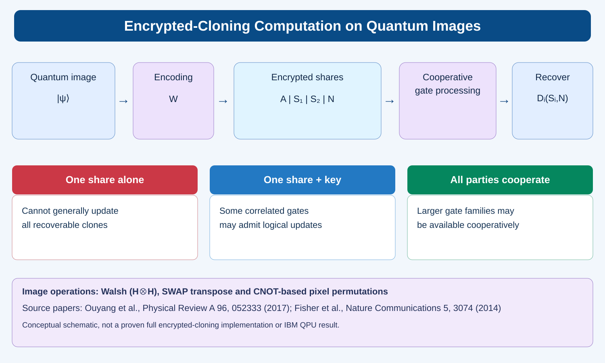

# Encrypted-Cloning Computation on Quantum Images: How It Works



This repository accompanies the supplied **encrypted-cloning quantum-image workflow**, the two uploaded research papers, and an exploratory Qiskit quantum-pattern-recognition implementation. The graphic is a **slide-style SVG recreation** of the original uploaded image.

## Research papers supplied

| Paper | Publication | Links |
|---|---|---|
| **Computing on quantum shared secrets**, Yingkai Ouyang, Si-Hui Tan, Liming Zhao and Joseph F. Fitzsimons | Physical Review A **96**, 052333 (2017) | [Official article](https://doi.org/10.1103/PhysRevA.96.052333) |
| **Quantum computing on encrypted data**, K. A. G. Fisher and collaborators | Nature Communications **5**, 3074 (2014) | [Official article](https://doi.org/10.1038/ncomms4074) |

See [paper details and exact original filenames](docs/papers.md).

## Encrypted-cloning quantum-image workflow

1. Amplitude encode a grayscale image as a quantum state.
2. Apply the conceptual encrypted-cloning encoder `W` to residual register `A`, clone registers `S1`, `S2`, and key register `N`.
3. Explore which operations can be performed locally or cooperatively while preserving recoverability.
4. Decode an output from `(S1,N)` or `(S2,N)`.

The overview **does not** establish that every illustrated gate is available under every resource or encoder.

## Included Qiskit pilot: Quantum image-pattern recognition

A separate four-qubit implementation estimates `|<image|template>|²` using a destructive SWAP test on two 2×2 amplitude-encoded image states. A common Pauli mask on both inputs leaves this overlap invariant. This intentionally reveals similarity, so it is **not a fully private encrypted-cloning protocol** and does not prove any quantum speedup.

```bash
pip install -e '.[test,plot]'
pytest -q
qepr --mode aer --shots 4096 --output results/aer.json
```

For a real IBM Quantum processor with configured Qiskit Runtime credentials:

```bash
pip install -e '.[ibm]'
qepr --mode ibm --backend YOUR_BACKEND --shots 4096 --output results/qpu.json
```

**Actual QPU results have not been collected.** The code implements a hardware execution path only.

## Uploaded attachments

The source material consisted of three attachments:

- `Encrypted Quantum Image Cloning Workflow(1).png` (original supplied slide graphic)
- `PhysRevA.96.052333.pdf` (publisher-formatted article)
- `ncomms4074(1).pdf` (publisher-formatted article)

These **exact binary originals** are available in the separately packaged downloadable project archive, but are not committed to this public repository. The public repository instead shows the recreated slide and provides official article links. This avoids implying public redistribution permission for publisher PDFs.

## Scope

See [security and scientific limitations](docs/security_and_scope.md). The two cited papers develop different encrypted-computation primitives; neither guarantees the security of the experimental mask-and-overlap example in this repository.
